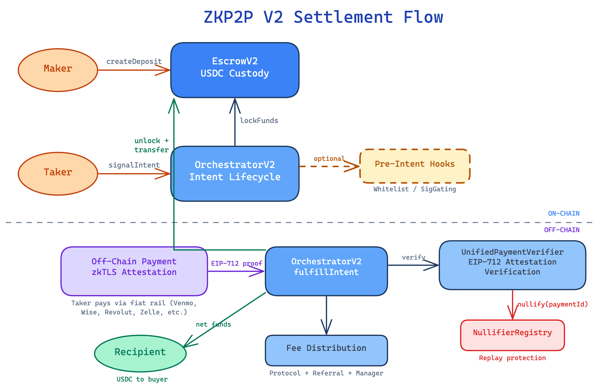
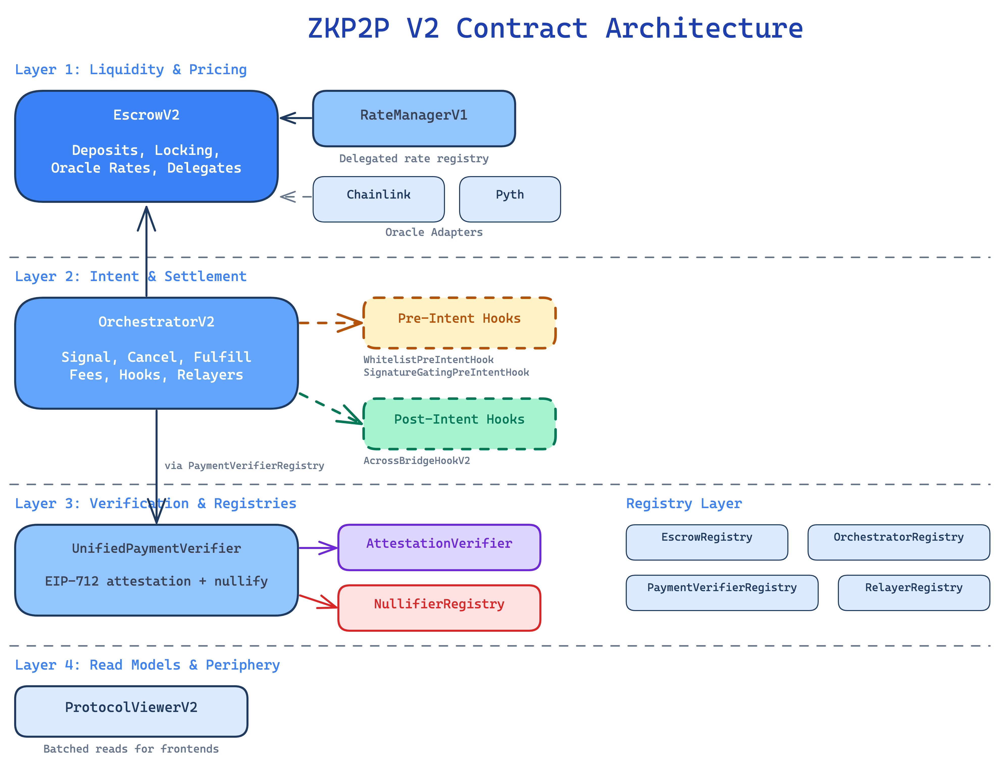

# zkp2p-v2-contracts

[](https://codecov.io/gh/zkp2p/zkp2p-contracts)

Smart contracts for the ZKP2P fiat on/off-ramp, with the current repository centered on the v2 system.
The pristine deployed pre-cut `OrchestratorV2` source is archived outside the compilation tree.
Superseded sources that executed deployment lanes and tests still need are in `contracts/archive/`; see
`contracts/archive/README.md` before assuming a contract is current.

- `EscrowV2`: maker liquidity, per-deposit payment configuration, oracle-backed pricing, delegated rate managers.
- `OrchestratorV2`: intent lifecycle, fee handling, pre-intent hooks, whitelist hooks, post-intent execution, and unrestricted account-level concurrency.
- `UnifiedPaymentVerifierV2`: shared attestation-based verifier registered across supported payment methods.
- `ProtocolViewerV2`: batched read model for deposits, intents, supported payment methods, and effective rates.

The repository still contains legacy v1 contracts and deploy scripts because v2 is deployed on top of shared protocol infrastructure, but the active development work over the last month has been concentrated in the v2 contracts, periphery, and deployment pipeline.

## Table of Contents

- [What Landed Recently](#what-landed-recently)
- [System Overview](#system-overview)
- [V3 Lifecycle Risk and Maker Groups](#v3-lifecycle-risk-and-maker-groups)
- [V2 Contract Inventory](#v2-contract-inventory)
- [Core Lifecycle](#core-lifecycle)
- [Rate Management Model](#rate-management-model)
- [Hooks and Extensibility](#hooks-and-extensibility)
- [Payment Verification Model](#payment-verification-model)
- [Repository Layout](#repository-layout)
- [Getting Started](#getting-started)
- [Build, Test, and Development Commands](#build-test-and-development-commands)
- [Deployment Model](#deployment-model)
- [Supported Payment Methods](#supported-payment-methods)
- [Testing Strategy](#testing-strategy)
- [Networks and Deployment Artifacts](#networks-and-deployment-artifacts)
- [Security Notes](#security-notes)

## What Landed Recently

The v2 surface was built out rapidly between February 20, 2026 and March 11, 2026. The main additions in that window are:

- `2026-03-02`: `EscrowV2`, `OrchestratorV2`, `ProtocolViewerV2`, `RateManagerV1`, `SignatureGatingPreIntentHook`, `WhitelistPreIntentHook`, `ChainlinkOracleAdapter`, `OrchestratorRegistry`, and the supporting v2 interfaces/mocks/tests landed.
- `2026-03-02`: the dedicated v2 deployment pipeline landed in `deploy/14_deploy_v2_system.ts`, `deploy/15_deploy_v2_periphery.ts`, and `deploy/16_configure_v2_payment_methods.ts`, with matching deployment tests.
- `2026-03-03`: `PythOracleAdapter` and its deployment/test coverage were added for Pyth FX feeds.
- `2026-03-04`: mainnet deployment scripts for `EscrowV2`, `OrchestratorV2`, and `RateManagerV1` landed.
- `2026-03-06`: the rate-floor model was refactored so `EscrowV2` enforces the final floor while `RateManagerV1` acts as a pure delegated rate registry.
- `2026-03-11`: `EscrowV2` gained batch currency/oracle configuration setters, including `setOracleRateConfigBatch`, `updateCurrencyConfigBatch`, and `deactivateCurrenciesBatch`.
- `2026-03-11`: `EscrowV2` added support for negative oracle spreads, allowing makers to quote below the oracle market rate while still preserving a positive multiplier invariant.
- `2026-03-11`: `OrchestratorV2` added support for multi-recipient referral fees, with `ReferralFeeLib` and updated interfaces/tests.
- `2026-03-11`: a staging redeploy script for `EscrowV2`, `OrchestratorV2`, and `SignatureGatingPreIntentHook` landed in `deploy/19_redeploy_escrowv2_orchestratorv2_staging.ts`.

In practice, "the latest contracts we have added in the past month" means the README should be read as a v2-first document.

## System Overview

ZKP2P is a non-custodial fiat-to-crypto settlement protocol. Makers deposit on-chain liquidity, takers lock a portion of that liquidity by signaling an intent, a payment proof is verified on-chain against an off-chain attestation, and settlement completes either directly to the taker or through a post-intent hook.

The v2 system is built around four layers:

1. Liquidity custody and pricing.
   `EscrowV2` stores deposits, payment methods, payee hashes, supported fiat currencies, fixed floors, oracle configs, rate-manager delegation, and outstanding intents.
2. Intent coordination and settlement.
   `OrchestratorV2` validates whether a taker can lock liquidity, snapshots fee terms and min intent size, verifies payments through the registry-selected verifier, and releases funds.
3. Verification and registries.
   `UnifiedPaymentVerifier` validates EIP-712 attestations and nullifies payments. Active registries define which escrows, orchestrators, hooks, and payment methods are valid. `RelayerRegistry` backs the deployed legacy V1 stack and the deployed prod `OrchestratorV2`.
4. Read models and periphery.
   `ProtocolViewerV2`, oracle adapters, bridge hooks, and pre-intent hooks provide the ergonomic layer used by frontends, routing systems, and privileged operators.

### High-Level Flow



### Contract Architecture



## Deposit Whitelist and Maker Groups

The deposit whitelist stack is available through the `OrchestratorV2` per-deposit whitelist hook:

- `AddressGroupRegistry`: anyone may create a curator-managed group. Curators can add or remove members,
  transfer control, configure an optional membership resolver, and opt into self-service membership.
- `WhitelistPolicy`: each deposit payment method owns an `enabled` switch and a bounded list of up to 10 allowed
  groups; direct taker addresses remain shared across all payment methods on the deposit. Only the escrow's
  recorded depositor may configure a deposit payment method, and `configureDeposit` updates its switch and groups
  while appending any direct takers to the deposit-wide whitelist. The policy keeps this configuration independently
  of the `OrchestratorV2` hook assignment.
  A governance owner may rotate the escrow registry that gates those writes via `setEscrowRegistry`. The owner
  cannot admit or reject a taker: whitelist enforcement allows a taker when enforcement is disabled for the
  intent's `(deposit, paymentMethod)`, the taker is directly whitelisted on that deposit, or the taker belongs to
  at least one group allowed by that tuple. Enabled policies with no matching address or group fail closed.
  Under `IntentLifecycleHookV1` the no-stake fast lane requires the tuple's whitelist to be **enabled**: a directly
  whitelisted address on a tuple whose whitelist is disabled is treated like any other taker and, on a payment
  method with a nonzero risk window, is routed through stake-backed dispute protection.
  Because enforcement is per tuple, a payment method the depositor adds to a deposit **after** its whitelist was
  configured or bootstrapped starts with that method's whitelist disabled: on a payment method with a nonzero risk
  window its takers are stake-backed by default, on a zero-window method it is open. Depositors configure the new
  tuple themselves, and the whitelist bootstrap can be re-run without a resume flag to pick up new unconfigured
  tuples while skipping those already configured or bootstrapped.

Group IDs are derived from the curator and registry group counter, and offchain consumers must key them by
chain, registry address, and group ID. Enforcement and groups are scoped to
`(escrow, depositId, paymentMethod)` while direct taker addresses are scoped to `(escrow, depositId)`, so a maker
can independently gate each payment method without maintaining duplicate direct-address lists.

## V2 Contract Inventory

This section covers the current v2 contracts and why each exists.

### Core Contracts

#### `EscrowV2`

`EscrowV2` is the v2 liquidity layer. Each deposit stores:

- depositor and optional delegate
- deposit token
- min/max per-intent amount range
- whether the deposit is currently accepting intents
- optional intent guardian
- optional `retainOnEmpty` behavior so the deposit configuration can survive empty liquidity
- per-payment-method verification data
- per-payment-method supported currencies
- per-currency fixed minimum conversion rates
- optional per-currency oracle rate configuration
- optional delegated rate manager configuration

Notable v2 behavior:

- Supports `createDeposit` and `depositTo`, so contracts can fund deposits on behalf of makers.
- Tracks outstanding intents inside escrow and reclaims liquidity when expired intents are pruned.
- Allows a delegate to manage deposit configuration without ownership transfer.
- Supports oracle-based pricing through `OracleRateConfig` with:
  - `adapter`
  - normalized `adapterConfig`
  - signed `spreadBps`
  - `maxStaleness`
- Supports negative oracle spreads as of March 11, 2026.
- Supports delegated pricing via `RateManagerV1`.
- Exposes batch management APIs for currency/oracle updates.

Important v2 management APIs include:

- `setOracleRateConfig`
- `setOracleRateConfigBatch`
- `updateCurrencyConfigBatch`
- `deactivateCurrenciesBatch`
- `setRateManager`
- `clearRateManager`
- `getEffectiveRate`
- `getManagerFee`

#### `OrchestratorV2`

`OrchestratorV2` is the settlement coordinator. It owns the intent lifecycle:

- `signalIntent`
- `cancelIntent`
- `fulfillIntent`
- `releaseFundsToPayer`
- `cleanupOrphanedIntents`
- escrow-driven `pruneIntents`

Key v2 behavior:

- Validates escrow and payment-method support through registries.
- Locks liquidity on signal and unlocks/releases on cancel or fulfill.
- Snapshots the deposit minimum at signal time to prevent sub-minimum fulfillments later.
- Snapshots delegated manager fee terms at signal time.
- Supports a generic pre-intent hook and a dedicated whitelist hook per deposit.
- Supports optional post-intent hooks through `IPostIntentHookV2`.
- Distributes protocol fees, manager fees, and multiple referral fees.
- Allows every account to hold multiple concurrent intents; V3 admission is governed only by the selected lifecycle hook.

Recent addition:

- Multi-recipient referral fee support landed on March 11, 2026.

#### `ProtocolViewerV2`

`ProtocolViewerV2` is the read-model contract for apps and indexers that need a single call to return:

- a deposit plus all configured payment methods
- effective per-currency rates after floor/oracle/manager logic
- outstanding intent hashes
- reclaimable liquidity from expired intents
- intents joined with their backing deposits

It is stateless and exists to make frontend queries cheaper and simpler.

#### `RateManagerV1`

`RateManagerV1` is the delegated rate registry used by `EscrowV2`.

It stores manager-owned pricing state keyed by a `rateManagerId`:

- manager address
- fee recipient
- fee and max fee
- minimum liquidity requirement
- display metadata (`name`, `uri`)
- per-payment-method / per-currency rates

Important semantics:

- As of March 6, 2026, `RateManagerV1` is a pure registry; floor enforcement is handled inside `EscrowV2`.
- Escrows opt into a manager via `setRateManager`.
- Managers can update one rate or batches of rates.
- The manager fee is snapshotted in `OrchestratorV2` when the taker signals an intent.

### Hook Contracts

#### `WhitelistPreIntentHook`

A depositor-managed private-orderbook mechanism:

- whitelist specific taker addresses per `escrow + depositId`
- only authorized orchestrators may invoke it
- used through the dedicated whitelist hook slot in `OrchestratorV2`

#### `SignatureGatingPreIntentHook`

An off-chain allowlist / RFQ gate:

- the deposit owner or delegate sets an authorized signer per deposit
- the taker includes ephemeral hook data with a signature and expiration
- the hook verifies a payload bound to:
  - orchestrator
  - escrow
  - deposit
  - amount
  - taker
  - recipient
  - payment method
  - fiat currency
  - conversion rate
  - referral fee hash
  - expiration
  - chain id

This is useful for private liquidity, per-trade approval, or off-chain risk checks.

### Oracle Adapters

#### `ChainlinkOracleAdapter`

- Accepts `abi.encode(address feed, bool invert)` raw config.
- Validates the feed and normalizes config to a compact packed format.
- Normalizes output to `1e18` precise units.
- Supports `feed == address(0)` as a constant `1.0` base rate, useful for USD-denominated USDC deposits.

#### `PythOracleAdapter`

- Added on March 3, 2026.
- Accepts `abi.encode(bytes32 feedId, bool invert)` raw config.
- Uses `Pyth.getPriceUnsafe` and returns a normalized `1e18` precise-unit rate plus publish time.
- Delegates staleness enforcement to `EscrowV2` via `maxStaleness`.

### Verifier Layer

#### `UnifiedPaymentVerifier` / `UnifiedPaymentVerifierV2`

The deployed v2 verifier uses the same contract implementation as `UnifiedPaymentVerifier`, but is deployed under the deployment name `UnifiedPaymentVerifierV2`.

Responsibilities:

- maintain the set of supported payment methods
- verify standardized EIP-712 payment attestations
- validate that the attested intent snapshot matches the live orchestrator intent
- nullify `(paymentMethod, paymentId)` combinations through `NullifierRegistry`
- emit normalized `PaymentVerified` events for off-chain reconciliation

#### `BaseUnifiedPaymentVerifier`

Shared base contract for:

- payment method configuration
- attestation verifier rotation
- orchestrator authorization
- nullifier writes

### Registry Layer

The v2 stack reuses and extends the existing registry model:

- `EscrowRegistry`: whitelists escrow contracts
- `OrchestratorRegistry`: whitelists both v1 and v2 orchestrators for escrow/verifier authorization
- `PaymentVerifierRegistry`: maps payment method hash to verifier and supported currencies
- `PostIntentHookRegistry`: whitelists post-intent hooks
- `RelayerRegistry`: backs deployed legacy V1 orchestrators and the deployed prod `OrchestratorV2`
- `NullifierRegistry`: stores consumed payment nullifiers

## Core Lifecycle

### 1. Maker Creates a Deposit

The maker funds `EscrowV2` and specifies:

- deposit token and amount
- min/max intent size
- supported payment methods
- per-method payee and verifier data
- per-method supported fiat currencies
- optional delegate
- optional intent guardian
- whether the deposit should remain configured after going empty

### 2. Deposit Pricing Is Defined

For each `(paymentMethod, currency)` pair, the deposit can use:

- a fixed floor only
- an oracle-backed rate with a spread
- a delegated manager rate through `RateManagerV1`

`ProtocolViewerV2` surfaces the final effective rate used by clients.

### 3. Taker Signals an Intent

`OrchestratorV2.signalIntent`:

- validates the escrow and deposit
- verifies payment-method and currency support
- runs the generic pre-intent hook, if present
- runs the dedicated whitelist hook, if present
- snapshots deposit min amount and manager fee terms
- stores the intent
- locks funds on `EscrowV2`

### 4. Fiat Payment Happens Off-Chain

The taker pays the maker using the selected payment rail. The off-chain attestation layer turns the payment evidence into a standardized signed payload.

### 5. Intent Is Fulfilled

`OrchestratorV2.fulfillIntent`:

- loads the stored intent
- resolves the correct verifier from `PaymentVerifierRegistry`
- verifies the payment proof
- checks the attested intent snapshot against on-chain data
- enforces the min-at-signal guarantee
- prunes the intent
- unlocks and transfers escrowed funds
- distributes protocol, referral, and manager fees
- optionally executes a post-intent hook

### 6. Expired Intents Can Be Reclaimed

If an intent expires:

- the escrow owner can reclaim liquidity during fund removal or withdrawal
- the orchestrator can prune orphaned intents
- `ProtocolViewerV2` exposes reclaimable liquidity so off-chain systems can model real availability

## Rate Management Model

Pricing is one of the biggest differences between the old system and v2.

### Fixed Floors

Every configured currency can carry a fixed minimum conversion rate. This is the hard floor that the settlement rate cannot violate.

### Oracle-Backed Floors

`EscrowV2` can derive rates from an oracle adapter plus a spread:

- Chainlink or Pyth supplies the base market rate.
- `spreadBps` adjusts the market rate.
- `maxStaleness` bounds stale data.
- The effective rate is returned in precise units.

Recent change:

- `spreadBps` is signed, so makers can quote above or below market. The implementation still requires the final multiplier to remain strictly positive.

### Delegated Managers

For programmatic market making, a deposit can delegate pricing to `RateManagerV1`:

- the deposit opts into a `rateManagerId`
- the manager updates rates off the critical settlement path
- `EscrowV2` combines manager-side rates with escrow-side floor enforcement
- `OrchestratorV2` snapshots the manager fee when the taker signals

This split keeps settlement safety inside escrow while letting pricing move quickly.

## Hooks and Extensibility

v2 introduces a clearer extension model around the intent lifecycle.

### Pre-Intent Hooks

Executed during `signalIntent`, before funds are locked:

- generic hook slot: arbitrary eligibility or policy checks
- whitelist hook slot: dedicated private-liquidity control

These hooks are configured per deposit by the depositor or delegate.

### Post-Intent Hooks

Executed during `fulfillIntent`, after verification and escrow release:

- direct recipient settlement remains the default
- hooks can route fulfilled funds into external workflows

### Registries as Safety Gates

The hook and orchestrator registry model prevents arbitrary external contracts from being inserted into the settlement path without explicit whitelisting.

## Payment Verification Model

The verification path is intentionally standardized across payment methods.

### Payment Method Registration

Each payment method is registered in two places:

1. `UnifiedPaymentVerifierV2` must recognize the payment method.
2. `PaymentVerifierRegistry` must map the method to the deployed verifier and its supported currencies.

### Attestation Model

The payment proof decodes into:

- payment details
- an intent snapshot
- witness signatures
- attested data and metadata

The verifier:

- reconstructs the EIP-712 digest
- checks the attestation through the configured attestation verifier
- validates the on-chain intent snapshot
- nullifies the payment ID
- returns the final release amount to `OrchestratorV2`

### Why the Nullifier Registry Matters

Payment IDs are nullified as `keccak256(paymentMethod, paymentId)` so the same raw ID cannot be replayed across methods.

## Repository Layout

```text
contracts/
  DepositCreationGuard.sol
  EscrowV2.sol
  IntentGuardian.sol
  OrchestratorV3.sol
  ProtocolViewerV2.sol
  RateManagerV1.sol
  StakeVault.sol
  archive/                          # superseded sources, still compiled for executed lanes and tests
  hooks/
  interfaces/
  lib/
  mocks/
  oracles/
  registries/
  unifiedVerifier/

archive/
  orchestrator-v2-pre-relayer-cut/  # pristine deployed legacy V2 source, excluded from compilation

deploy/
  00_deploy_system.ts
  01_deploy_unified_verifier.ts
  02_add_venmo_payment_method.ts
  ...
  14_deploy_v2_system.ts
  15_deploy_v2_periphery.ts
  16_configure_v2_payment_methods.ts
  17_deploy_pyth_oracle.ts
  18_redeploy_escrowv2_ratemanager.ts
  19_redeploy_escrowv2_orchestratorv2_staging.ts
  deploy_summary.ts

test-foundry/
  deterministic/
  fuzz/
  invariant/
  mocks/                            # test doubles used only by Foundry tests
```

## Getting Started

### Prerequisites

- Node.js 20.20.2 (the version pinned in CI)
- Yarn 4
- Foundry v1.7.1
- a `.env` copied from `.env.default`

### Initial Setup

```bash
corepack yarn install --immutable
cp .env.default .env
```

Fill the relevant environment variables, including the ones used by deployment and verification flows:

- `ALCHEMY_API_KEY`
- `BASE_DEPLOY_PRIVATE_KEY`
- `TESTNET_DEPLOY_PRIVATE_KEY`
- `BASESCAN_API_KEY`
- `ETHERSCAN_KEY`
- `INFURA_TOKEN`

### Local Development

Start a chain:

```bash
yarn chain
```

Deploy locally:

```bash
yarn deploy:localhost
```

For wallet-based local testing, import Hardhat account `#0` into your wallet.

## Build, Test, and Development Commands

### Core Commands

- `yarn compile`: compile Solidity contracts
- `yarn build`: clean, compile, generate typechain bindings, and transpile TypeScript
- `yarn clean`: remove compiler, coverage, and generated build artifacts
- `yarn typechain`: generate TypeChain bindings
- `yarn transpile`: run `tsc`

### Test Commands

- `corepack yarn test`: run the complete always-on Foundry suite
- `corepack yarn test:deterministic`: run deterministic unit, integration, and deployment tests
- `corepack yarn test:fuzz`: run the real-contract property suite at 512 cases per property
- `corepack yarn test:invariant`: run handler-driven invariants at 128 runs × 64 calls
- `forge test --match-path '<path>' --match-test '<name>'`: isolate a file or named test

See [TESTING.md](./TESTING.md) for suite design, seed reproduction, coverage mechanics, and contribution rules.

### Coverage

- `corepack yarn coverage`: run deterministic coverage once, build accurate Foundry LCOV, and enforce the permanent Foundry baseline floors

Coverage is deliberately outside the pull-request critical path. Code pull requests run the complete deterministic,
fuzz, invariant, integration, and deployment Foundry suite. The `Release readiness` workflow runs package and
localhost-deployment checks for release-surface pull requests, every relevant push to `main`, and manual dispatches;
its four coverage lanes run on `main` and manual dispatches only. Markdown, agent guidance, audits, and deployment
logs do not start these workflows when the entire PR or push is limited to those paths. A docs-only follow-up inside
a mixed PR still reruns CI because GitHub evaluates pull-request path filters against the complete PR diff.

Before publishing the contracts package, promoting a release branch, or deploying to Base staging or Base, verify
that the exact release SHA has a green complete Foundry suite and a green `Release readiness` run including package,
localhost-deployment, and coverage jobs. A green contract-only pull request is not release-readiness evidence because
the deferred workflow runs after merge to `main`; if the release SHA has not run there, dispatch `Release readiness`
on its release ref and wait for it. Never reuse coverage or deployment evidence from another SHA.
An ignored documentation-only head may inherit the immediately preceding green runtime SHA only after its complete
intervening diff is proven to contain no executable, package, configuration, or deployment input.

### Packaging Commands

- `yarn pkg:extract`
- `yarn pkg:build`
- `yarn pkg:clean`
- `yarn pkg:test`

## Deployment Model

The deployment pipeline is layered because v2 reuses shared protocol infrastructure.

### Legacy Base System

Scripts `00` through `13` deploy and configure the original shared system and payment method scaffolding. These remain relevant because v2 builds on:

- existing registries
- the shared attestation verifier
- shared payment-method config artifacts

### V2 Deployment Sequence

#### `deploy/14_deploy_v2_system.ts`

Deploys and wires:

- `OrchestratorRegistry`
- `EscrowV2`
- `OrchestratorV2`
- `UnifiedPaymentVerifierV2` (same implementation as `UnifiedPaymentVerifier`)

Then it:

- adds both v1 and v2 orchestrators to `OrchestratorRegistry`
- adds `EscrowV2` to `EscrowRegistry`
- grants the v2 verifier write permissions in `NullifierRegistry`
- transfers ownership of the ownable v2 contracts to the configured multisig

#### `deploy/15_deploy_v2_periphery.ts`

Deploys:

- `WhitelistPreIntentHook`
- `SignatureGatingPreIntentHook`
- `RateManagerV1`
- `ChainlinkOracleAdapter`
- `ProtocolViewerV2`

#### `deploy/16_configure_v2_payment_methods.ts`

Configures the v2 verifier and registry for all supported methods:

- add payment methods to `UnifiedPaymentVerifierV2`
- repoint `PaymentVerifierRegistry` entries to the v2 verifier
- save payment method snapshots
- emit Safe batch calldata when the deployer is not the registry owner

This script currently covers:

- Venmo
- Revolut
- Cash App
- Wise
- Mercado Pago
- Zelle
- PayPal
- Monzo
- N26
- Alipay
- Chime
- Luxon

#### Additional Recent Deployment Scripts

- `deploy/17_deploy_pyth_oracle.ts`: deploys the Pyth adapter
- `deploy/18_redeploy_escrowv2_ratemanager.ts`: redeploys `EscrowV2` and `RateManagerV1` after the rate-floor refactor
- `deploy/19_redeploy_escrowv2_orchestratorv2_staging.ts`: staging-specific redeploy for `EscrowV2`, `OrchestratorV2`, and the signature-gating hook
- `deploy/32_deploy_deposit_creation_guard.ts`: deploys the stateless `DepositCreationGuard` for atomic
  pre/post assertions around `EscrowV2.createDeposit`

The canonical `DepositCreationGuard` was deployed once on Base at
`0x0D765BD7322b9E8C85F66Cc3353dBc6B6d602e2f` in transaction
`0xaa732525f07f9919e3e5ac991430f7f5e7a88e945a4204a23571c14d1a63cfaf`. Its canonical production artifact is
recorded under `deployments/base_prod/DepositCreationGuard.json`. Because the guard is stateless and receives the
target escrow on each call, staging intentionally reuses this production Base deployment. No separate staging
contract deployment or duplicate staging artifact is required.

#### Deployment Summary

`deploy/deploy_summary.ts` prints both legacy and v2 addresses and writes Safe Transaction Builder batch files when multisig actions are pending.

### Common Deployment Commands

- `yarn deploy:localhost`
- `yarn deploy:base`
- `yarn deploy:base_staging`

These are the supported deployment entrypoints and all route through `scripts/deployActive.ts`. Do not invoke
`hardhat deploy` directly: it bypasses the immutable-lane hash and retirement filter.

### V3 Groups Cutover

The lifecycle rollout is split into explicit lanes. Production-executed numbered scripts are immutable
provenance: new behavior gets a new lane, while retirement and live-state checks stay in current helpers
or runner metadata. Lane 31 verifies and cuts over the V3 payment-binding pair, lane 33 owns the
IntentGuardian fee update, lane 34 is the immutable, retired lane that shipped the opt-in dispute/staking
stack, and lanes 36 and 37 are the current deploy-only lanes for the payment-method-scoped policies.

`deploy/30_deploy_v3_lifecycle_stack.ts` is the exact historical groups-only source used in production.
Its original implementation deploys `WhitelistLifecycleHook` and `OrchestratorV3` with the lane-29
`WhitelistPolicy` dependency. The supported runner first verifies the historical source digest, then mounts
`deployments/activeDeploymentLanes/30_deploy_v3_lifecycle_stack.ts` under lane 30's filename. The wrapper
returns without invoking the historical implementation when the live O3 already uses a bytecode- and
configuration-verified predecessor or successor dispute hook; otherwise it delegates to lane 30's exact
historical function and skip behavior. Do not move live artifacts aside or rerun lane 30 to replace the
current stack. A future O3 deployment requires a new numbered lane.

`deploy/31_deploy_v3_payment_binding_stack.ts` is the state-aware payment-binding and hard-cutover lane.
On Base staging and Base it pins the existing `NullifierRegistryV2` and `UnifiedPaymentVerifierV3`
addresses, runtime code hashes, immutable dependencies, owners, active method order, exact currency arrays,
and writer set. Missing, partial, or mismatched production-like artifacts fail closed; only local networks
may deploy the pair. Base staging is already fully cut over and is verification-only: its registries are
EOA-owned, so the script refuses to approximate an atomic cutover with 22 independent transactions. On Base,
`ENABLE_BASE_V3_PAYMENT_BINDING_CUTOVER=true` removes all ten methods in reverse order, re-adds them in
original order against UPV3, and revokes UPV1 and UPV2 from the legacy nullifier registry. This preserves
the registry order and produces exactly 22 atomic Safe calls. Never route a method back to a retired verifier
after this one-way cutover.

`deploy/32_deploy_and_activate_dispute_lifecycle_stack.ts` is the exact executable source used for the
production dispute-stack deployment. It remains at its original path only as immutable audit provenance;
it is not current read-only code. The supported runner verifies its digest, excludes the exact file from
all tagged and untagged runs, and rejects both historical lane-32 tags. Never invoke it directly.
`deployments/predecessorDisputeStack.ts` owns current read-only predecessor address, deployment-bytecode,
and runtime-bytecode verification used by lane 34 and the Safe tooling.

`deploy/34_deploy_opt_in_dispute_lifecycle_stack.ts` is the exact executable source that deployed the
`StakeVaultOptIn`, `DisputeProtectionPolicyOptIn`, and `IntentLifecycleHookV1OptIn` records on both
networks and, through its Safe batch, activated them on Base. It is immutable and retired: the supported
runner verifies its digest, excludes it from every tagged and untagged run, and rejects both of its tags.
`yarn verify:dispute-opt-in-safe-batch` and `yarn simulate:obsolete-dispute-safe-batch` remain as tooling
for that executed history. Lanes 39/40 superseded the Base `*OptIn` trio on 2026-08-28, and
`PREDECESSOR_DISPUTE_STACKS` records it as the predecessor of the selected Base stack; the Base-staging
`*OptIn` trio was deployed but never activated.

`deploy/36_deploy_method_scoped_whitelist_policy.ts` deploys `WhitelistPolicyMethodScoped`, the
payment-method-scoped `WhitelistPolicy`, against the existing `AddressGroupRegistry`, `EscrowRegistry`,
and `OrchestratorRegistry`, and hands ownership to governance. Use `yarn deploy:method-scoped-policy:base_staging`
or `yarn deploy:method-scoped-policy:base` with `ENABLE_STAGING_METHOD_SCOPED_WHITELIST_POLICY_DEPLOYMENT=true`
or `ENABLE_BASE_METHOD_SCOPED_WHITELIST_POLICY_DEPLOYMENT=true`. The lane never mutates the registries and
never touches the lane-29 policy or any V2 deposit hook; an existing record is canonical-checked and reused.

`deploy/37_deploy_method_scoped_dispute_lifecycle_stack.ts` deploys `DisputeProtectionPolicyMethodScoped`
and `IntentLifecycleHookV1MethodScoped`, wiring the hook to the lane-36 policy and the fresh dispute policy
while reusing the network's pinned `DisputeVerifier`, `DisputeNullifierRegistry`, and — because `StakeVault`
is unchanged and holds live taker stake — the predecessor `StakeVault` itself (`StakeVaultOptIn` on Base, the
lane-32 vault on Base staging). The fresh policy becomes that vault's controller only through the vault's
delayed two-step handover in the activation lane; a `StakeVaultMethodScoped` record exists on localhost only. The lane
executed deploy-only on Base staging and Base on 2026-08-27 and is immutable and retired for live networks: the runner
refuses its tags, and `deployments/activeDeploymentLanes/37_deploy_method_scoped_dispute_lifecycle_stack.ts` mounts it
only for `localhost`/`hardhat`, where it still deploys the local method-scoped stack. The historical deploy-only run
authorized only the
fresh hook, applies non-zero risk windows only to PayPal, Venmo, and Cash App, and on Base initiates the
policy's two-step ownership transfer for the Safe to accept later. It is
transaction-by-transaction resumable and leaves the active O3 hook and the dispute-registry writer set
unchanged. The method-scoped policy is on by default for every payment method with a nonzero risk window
(paypal, venmo, cashapp) and can be opted out per deposit payment method by the depositor; depositor
opt-outs on the passive policy are expected, and only lifecycle activity on it invalidates the deploy-only
preparation; the live vault is never inspected.
`deployments/predecessorDisputeStack.ts` pins what the lane replaces per network in
`METHOD_SCOPED_PREDECESSOR_DISPUTE_STACKS`; `PREDECESSOR_DISPUTE_STACKS` keeps describing the predecessor of
the currently selected stack until activation.

`deploy/38_activate_method_scoped_dispute_lifecycle_stack.ts` activates the lane-37 stack. It is
tag-only: `yarn deploy:dispute-method-scoped-activation:base_staging` and
`yarn deploy:dispute-method-scoped-activation:base` run the lane under
`DEPLOY_ACTIVE_TAG=38_activate_method_scoped_dispute_lifecycle_stack`; every untagged run skips it, a
tagged local run throws because there is no predecessor stack, and a lane-38 flag without the tag throws
before any chain read. Every read is pinned to one block and reduced into a single activation state
(`deployed`, `rotation-proposed`, `active`, or `unrecognized`, which aborts). Base staging advances one
deployer-EOA step per run with `PREPARE_STAGING_V3_DISPUTE_METHOD_SCOPED_ACTIVATION=true` (dry run) or
`ENABLE_STAGING_V3_DISPUTE_METHOD_SCOPED_ACTIVATION=true`: pause predecessor admissions, propose the fresh
policy as the vault controller, release matured predecessor intents, accept the controller once the delay
has elapsed and no predecessor lock is open, add the fresh registry writer, set the O3 hook, and remove
the predecessor writer; the lane reports `controller-delay` / `predecessor-drain` waiting states instead
of guessing. Base produces two unsigned Safe batches, each headed by a freshly deployed on-chain guard
contract that re-checks the whole trust surface inside the Safe transaction:

- `ENABLE_BASE_V3_DISPUTE_METHOD_SCOPED_ROTATION_PREPARATION=true` — guard, optional
  `acceptOwnership()` on the fresh policy, `setAdmissionsPaused(true)` on the predecessor policy, and
  `proposeController(freshPolicy)` on the reused vault.
- `ENABLE_BASE_V3_DISPUTE_METHOD_SCOPED_CUTOVER_PREPARATION=true` — only after the controller delay with
  zero live predecessor locks: guard, `acceptVaultController()`, `addWritePermission(freshPolicy)`,
  `removeWritePermission(predecessorPolicy)`, and `setLifecycleHook(freshHook)`.
- `ENABLE_BASE_V3_DISPUTE_METHOD_SCOPED_RELEASE_MATURED=true` — permissionless release of matured
  predecessor intents from the deployer so the cutover precondition can be met.

Each batch is simulated on a pinned Base fork with a postcondition contract appended, then written to
`deployments/outputs/safe-batches/base_method_scoped_{rotation,cutover}.json` with a `.sha256.json`
sidecar that pins the proof snapshot, guard identity, and source SHA. Run
`yarn verify:method-scoped-safe-batch --batch rotation|cutover` immediately before the Safe executes;
it re-derives the guard constructor arguments from the manifest, re-proves the guard and postcondition
deployments, re-reads the chain at a fresh block, and re-runs the simulation. Artifact-child verification allows
unrelated commits after the recorded source SHA only when every producer and verifier path in
`ACTIVATION_PROTECTED_PATHS` is unchanged. No script signs. Lane 37
must be retired before activation (its skip asserts the predecessor hook is still live), lane 38 is
pinned after its first live transition, and the `active-dispute-stack.json`,
`PREDECESSOR_DISPUTE_STACKS`, evidence, and `WhitelistPolicy` package-alias flips land in recording PRs
after each execution. Before lane 38 can run:

- [x] Lanes 36 and 37 have executed deploy-only on Base staging and Base and their records are committed,
      and lane 37 is retired in `deployments/immutableDeploymentLanes.ts`.
- [ ] `yarn whitelist:bootstrap` has populated `WhitelistPolicyMethodScoped` on each network.
- [ ] `zkp2p-indexer` indexes the fresh addresses and the tuple-scoped `EnabledUpdated` /
      `DisputeProtectionEnabledUpdated` events.
- [ ] `@zkp2p/contracts-v2` publishes the tuple-scoped ABIs and replacement addresses, and its consumers upgrade.

`deploy/39_deploy_method_scoped_vault_stack.ts` and `deploy/40_activate_method_scoped_vault_stack.ts` supersede
lane 38 (retired unexecuted on Base on 2026-08-28). Lane 39 deploys a dedicated `StakeVaultMethodScoped` with
`DisputeProtectionPolicyMethodScopedStaked` and `IntentLifecycleHookV1MethodScopedStaked` bound to it — controller
set at deployment, so activation needs no two-day rotation — using `yarn deploy:dispute-method-scoped-vault:base_staging`
/ `:base` with `ENABLE_{STAGING,BASE}_V3_DISPUTE_METHOD_SCOPED_VAULT_DEPLOYMENT=true` (deploy-only; Base initiates the
vault and policy ownership transfers to the Safe). Lane 40 (`yarn deploy:dispute-method-scoped-vault-activation:*`,
tag-only) advances Base staging one deployer step per run (add writer → set hook → remove the lane-32 writer) and on
Base prepares one guarded cutover batch (guard → conditional `acceptOwnership` on vault and policy → add fresh writer →
`setLifecycleHook`) plus a later guarded writer-removal batch that is only allowed once every OptIn-opened intent is
terminal and `StakeVaultOptIn` holds no locks. Artifacts live at
`deployments/outputs/safe-batches/base_method_scoped_vault_{cutover,writer_removal}.json`; run
`yarn verify:method-scoped-safe-batch --batch vault-cutover|vault-writer-removal` immediately before the Safe executes.
The same protected-path rule keeps these batches valid across unrelated merges without weakening their source,
artifact-pair, or live-chain checks.
Both lanes are immutable and pinned after their 2026-08-28 Base execution.
Stake in the old vaults is abandoned: stakers withdraw once their locks release and takers re-stake in the new vault
before the cutover; that readiness is part of `CONFIRM_BASE_V3_DISPUTE_METHOD_SCOPED_VAULT_DOWNSTREAM_READY`.

`deploy/45_deploy_bypass_dispute_stack.ts` is retargeted to `StakeVaultV2` (zero controller delay),
`DisputeProtectionPolicyV2`, `IntentLifecycleHookV2`, `UnifiedPaymentVerifierV4` and `OrchestratorV4`.
This cascade/O4 source has not executed on Base or Base staging. The existing tag and
`ENABLE_{STAGING,BASE}_V3_DISPUTE_BYPASS_STACK_DEPLOYMENT=true` select resumable deploy-only steps.
Lane 45 initializes the vault controller, authorizes HookV2, sets PayPal/Venmo windows and configures O4
with O3's registries, fees and `allowMultipleIntents`. O4 stays unregistered; Base starts vault/policy
two-step ownership transfers and transfers UPV4/O4 ownership directly to the Safe.
Only the exact superseded staging UPV4 address `0x3fe38Afdfa85A9E14D9b0ae5A5B2E577A8a71DA7` with its
pinned runtime hash may be replaced. Lane 45 deletes that record and deploys a different address.
Pre-cutover binding checks use the pinned retired verifier independently of the mutable record, including
after a crash between deletion and deployment; other identity or runtime mismatches fail closed.
The cascade policy starts with protection on by default; opt-outs are not carried over; depositors opt out again on it.
Historical lane 45 first executed on staging on 2026-10-11 from `f9eab7f`. The stake-owner bypass trio
replaced that first trio on 2026-10-13 from `285bc5c`; UPV4 and its record were unchanged by that run.

`deploy/46_activate_bypass_dispute_stack.ts` activates the cascade stack with O4 registration last.
O3 stays registered with its August hook on Base/local; staging restores that hook as its first action.
Lane 46 adds the cascade dispute writer, makes fresh UPV4 the sole `NullifierRegistryV2` writer and
routes every method to it with identical currencies and method order (reverse-remove, in-order-add).
Existing dispute writers remain passive, including staging's superseded bypass policy. Every PENDING
intent opened by that stale policy blocks verifier rotation and every later action, including staked
intents that could switch to no-stake; cancel or prune them before continuing.
Live runs require `DEPLOY_ACTIVE_TAG=46_activate_bypass_dispute_stack`. Staging runs lane 45 first
(it reports open stale intents), then lane 46 `ENABLE_STAGING_V3_DISPUTE_BYPASS_ACTIVATION=true` with
both `CONFIRM_STAGING_V3_DISPUTE_BYPASS_ACTIVATION` and
`CONFIRM_STAGING_V3_DISPUTE_BYPASS_DOWNSTREAM_READY` set to `true`, then lane 46
`PREPARE_STAGING_V3_DISPUTE_BYPASS_ACTIVATION=true` to verify `active`. Do not prepare lane 46 first.
Keep one build through deployment and verification; avoid untagged staging runs until recording merges.
Downstream readiness requires attestations with the 448-byte payload and signed extension words
  for the new UPV4 domain for both orchestrators
(attestation-service #529) and clients routing new intents to O4. RelayerRegistry is shared; its relayers
are allowed on every orchestrator.
Base preparation requires `ENABLE_BASE_V3_DISPUTE_BYPASS_CUTOVER_PREPARATION=true`, both Base
`CONFIRM_` flags and `CONFIRM_BASE_V3_DISPUTE_BYPASS_RELEASE_READY_SHA` matching the source SHA.
The unsigned atomic Safe batch is guard → conditional vault/policy `acceptOwnership` → activation
actions → `addOrchestrator(O4)`. No canonical Base call targets O3. The guard checks O3's August hook;
the deployed postcondition runs only in the pinned fork simulation. Artifacts remain
`deployments/outputs/safe-batches/base_dispute_bypass_cutover{,.sha256}.json`; run
`yarn verify:dispute-bypass-safe-batch` immediately before Safe execution. Preparation never signs,
proposes or executes a Safe transaction.
Historical lane 46 executed on staging on 2026-10-12 from `a6970aa` in 32 actions over three runs.
On 2026-10-13, `285bc5c` activated the replacement trio: add its writer, switch O3's hook, remove the
abandoned writer. Lanes 45/46 took ten transactions at deployer nonces 16340–16349; block 52531092
reduced to `active`. That temporary replacement executor was deleted in the recording PR, which then
restored the lanes to `314298e`; the current source is now retargeted and remains unexecuted on both networks.
The first staging trio is abandoned: no protected intent, stake, live reference or writer permission.
The recorded 2026-10-13 trio remains `StakeVaultBypass` `0x6b32df91EB92637F64bA444996702fC9582C87a1`,
`DisputeProtectionPolicyBypass` `0x1a9C442E3Ae99fB08313242fCdA601431027B39C` and
`IntentLifecycleHookV1Bypass` `0xec27Cc47370267c843177375c3Fe43D29D498bB4`. That execution kept UPV4,
all 14 routes, currencies, method order and the sole NRV2 writer unchanged. The August policy
`0x484fA07F085eb66bb7C2b649Ea9d5894b2B6681c` stayed a passive writer. No opt-outs were mirrored in those
ten transactions; the historical `active` result did not attest opt-out mirroring.
Staging aliases/evidence still describe that executed bypass stack; Base retains MethodScoped aliases
and UPV3 binding. Superseded identities live in `BYPASS_SUPERSEDED_STAGING_DEPLOYMENTS`; fresh
`BYPASS_RECORDED_DEPLOYMENTS` pins are empty until recording. The staging recording PR must save all
five fresh records and address/runtime pins, update the committed-record test after replacing UPV4's
JSON, restore staging aliases/evidence/`PREDECESSOR_DISPUTE_STACKS.base_staging` to main's August O3
selection, regenerate outputs with the O4 stack exported by name and update these docs.
Base requires separate approvals for lane 45, its recording PR with pins, and lane-46 preparation;
after activation, record evidence/outputs and flip `BYPASS_PAYMENT_BINDING_RECORDED.base` to `true`.
Canonical dispute aliases keep describing O3's August stack; O4 consumers use `StakeVaultV2` and
the other O4 records by name. Retain stale vault exports for withdrawals. Lane 31 selects UPV4 through
the binding flag independently of aliases; staging lanes 35/41/43 still pin UPV3 and fail closed.
Lanes 45/46 remain unpinned until Base executes. RC publication is a later, separately approved boundary.
Local aliases select MethodScopedStaked while lanes 45/46 deploy and activate O4 beside O3. Restart the
node before another full `yarn deploy:localhost`; lanes 31/39 retain historical local wiring checks.

The package exports the currently selected (latest) addresses for each network, and consumers should treat them as
the addresses to use.

Dispute-evidence issuance in `attestation-service` remains a separate follow-up and is intentionally not implemented
by these contract lanes. Only PayPal and Venmo receive non-zero onchain risk windows; Cash App and every other
active payment method have a zero window and do not require stake.

`deploy/42_retire_dispute_risk_windows.ts` is the governed write behind that statement (decided 2026-08-28). It zeroes
the `RETIRED_DISPUTABLE_PAYMENT_METHODS` risk windows on `DisputeProtectionPolicyMethodScopedStaked`, which makes
`onIntentSignaled` a no-op and `isDisputeProtectionEnabled` false for the method while PayPal and Venmo keep their
14-day windows. Base executed it at Safe nonce 80 on 2026-08-28 (safeTxHash `0x16a7…4650`, tx
`0x4824a78931e3785cd69e4aa1c669c2f86cf0ccbaf22066d54f7f7ace55156f8a`; batch and chunk plan under
`deployments/outputs/safe-batches/base_retire_cashapp_risk_window*`; their "lane 41" label predates the UPI
payment method claiming that number). Base staging executed the deployer-EOA write on 2026-09-02
(tx `0x5cde17a0c59ba4b606b19b9d09b468af06cd283d256984160e9627aaff4dc451`). Cash App therefore reads a zero risk
window on both networks, the evidence and package manifest say `0` everywhere, and lane 42 is immutable and pinned
after that first execution; it stays mounted and its tagged runs skip while every retired window reads zero.

### Whitelist Bootstrap

`yarn whitelist:bootstrap` discovers active deposits from a configurable raw GraphQL endpoint and
selects only deposits with an active Venmo or PayPal payment method. It deduplicates the
matching rows by deposit and payment method and simulates canonical `bootstrapDeposits` batches against the
lane-36 `WhitelistPolicyMethodScoped` record for the ordered, non-empty, distinct group list supplied through
`WHITELIST_GROUP_IDS`. It refuses the lane-29 deposit-scoped policy address and fails closed on a network whose
`WhitelistPolicyMethodScoped` artifact does not exist yet. It imports no indexer
schema package, so the contracts and indexer packages remain acyclic. Discovery is a dry-run by
default; mutation and Safe output require both the exact expected deposit count and the printed
selection digest, which bind the eligible onchain-filtered set and the ordered group IDs. Withdrawn, method-inactive,
self-configured, and already-bootstrapped tuples are skipped and reported; the count, digest, and generated batches
cover only the eligible set. All discovery modes enforce a configurable maximum.

- Staging execution requires `BOOTSTRAP_EXECUTE=true` and the current policy owner's private key.
- Production Safe preparation requires `BOOTSTRAP_SAFE_OUTPUT_FILE`; it emits unsigned Transaction
  Builder JSON owned by the policy's onchain owner, and never signs or submits it.
- Direct execution and Safe output are mutually exclusive. Every batch is simulated and its calldata
  decoded and checked before either execution or file output.
- Base execution is pinned to the canonical production indexer and deployment artifacts, and every configured
  group ID must be one of the known production groups recorded by the Base `AddressGroupRegistry`. It also requires
  `BOOTSTRAP_CONFIRM_PRODUCTION=true`.
- Already-bootstrapped tuples are always skipped, so `BOOTSTRAP_ALLOW_COMPLETED` is no longer required. The script
  rechecks policy ownership and tuple state before each submitted batch.
- Direct execution uses the receipt RPC for confirmation and bounded post-receipt state reads. It computes
  EIP-1559 fees from the latest base fee with a `0.001` gwei priority fee and refuses to submit above
  the `0.02` gwei default max-fee ceiling; both values are configurable through the documented env.
- Run `yarn whitelist:bootstrap --self-test` for the embedded calldata/Safe validation and
  `yarn whitelist:bootstrap --help` for the complete environment-variable reference.

### Verification Commands

- `yarn etherscan:base`
- `yarn etherscan:base_staging`

## Supported Payment Methods

The repository contains deployment coverage for the following payment rails in the current v2 configuration flow:

- Venmo
- Revolut
- Cash App
- Wise
- Mercado Pago
- Zelle
- PayPal
- Monzo
- N26
- Alipay
- Chime
- Luxon

Payment-method specific provider configuration lives under `deployments/verifiers/`.

## Testing Strategy

Foundry is the sole contract test system. The suite is separated by assurance type:

- `test-foundry/deterministic/`: unit behavior, integration, deployment topology, events, reverts, state, balances, and authorization boundaries
- `test-foundry/fuzz/`: bounded real-contract properties that add input breadth beyond deterministic cases
- `test-foundry/invariant/`: multi-actor handlers, ghost accounting, lifecycle conservation, and nullifier uniqueness

The default `corepack yarn test` command runs every layer with the centrally configured run counts. The PR suite has
no reduced fuzz counts, pending cases, or ignored test failures, but non-runtime paths are skipped and coverage is
deferred. During development, run the affected file first and rely on the exact commit's PR suite for the complete
gate. Run or confirm the deferred coverage and release-readiness workflow only when preparing a package, release
branch, or deployment, or when changing its configuration.

## Networks and Deployment Artifacts

The repo is configured primarily for:

- Base
- Base staging
- localhost / hardhat

Artifacts and exports live in:

- `deployments/<network>/`
- `deployments/outputs/`

The deploy scripts also reference current network parameters such as:

- USDC addresses
- multisig address
- protocol fee recipient
- dust recipient
- Pyth contract address

These parameters live in `deployments/parameters.ts`.

## Security Notes

- The contracts are designed around explicit registry-based authorization rather than open-ended plugin injection.
- `EscrowV2` and `OrchestratorV2` both use reentrancy guards on state-changing flows that interact with external contracts.
- Payment replay protection depends on `NullifierRegistry`.
- Oracle safety depends on both adapter validation and escrow-side `maxStaleness`.
- Manager fees are capped and snapshotted at signal time.
- The README is not a full audit report. Contract behavior should be read alongside the source and tests before making deployment or integration assumptions.

## License

MIT

### UPV4 return compatibility

UPV4 accepts the same 448-byte `abi.encode(PaymentDetails, IntentSnapshot)` payload as UPV3,
followed by optional signed extension bytes. The entire `data`, including the extension, is
covered by `dataHash` and witness signatures. UPV4 returns the extension untouched and uninterpreted.
Extension fields occupy dedicated 32-byte words: word 0 is `balanceFunded` (only 0 or 1),
word 1 is the attested `conditionsHash`, and words 2+ are reserved and ignored by the current hook.
Missing complete words read as zero. Plain payloads are 448 bytes, balance-funded payloads are
480 bytes, and conditioned payloads are 512 bytes (word 0 may be 0 or 1).
The old 480-byte encoding remains harmless: its trailing bool becomes extension word 0.

The fully static result preserves the V1 `success`, `intentHash`, `releaseAmount` prefix,
then returns the uncapped `attestedReleaseAmount`, verified `PaymentDetails`, and signed/validated
`IntentSnapshot`. `balanceFunded` is not a result field. Dynamic extension bytes are a separate
trailing return value; unsigned metadata is never returned. O3 reads the V1 prefix with or without
extension bytes. O4 forwards the raw extension and opaque `lifecycleHookData` saved before pruning to
its snapshotted IntentLifecycleHookV2. The hook is stateless by design: per-intent data lives only in O4,
and the hook decodes and validates it because governance can replace hooks for future intents while O4
is not upgradeable. Manual release forwards the saved data and an empty extension; the hook skips the
attestation comparison and extension validation and uses `balanceFunded = false`.

IOrchestratorV4 keeps Intent and FulfillIntentParams ABI-identical to V3. Its SignalIntentParams
keeps V3's fields in order and appends `bytes lifecycleHookData` after `data`. Non-empty data requires
a current lifecycle hook (`LifecycleHookDataRequiresHook`) and a gating service for the deposit's
payment method (`LifecycleHookDataRequiresGatingService`). O4 appends `keccak256(lifecycleHookData)`
to the gating message and verifies the service's signature. Empty data needs no gating service,
preserves the plain V3 message byte-for-byte and is never written to the hook-data mapping.
`getIntentLifecycleHookData(intentHash)` returns the bytes until pruning.

IntentLifecycleHookV2 accepts empty data or exactly 64 bytes of `abi.encode(uint8(1), bytes32 conditionsHash)`
with a nonzero hash; malformed data reverts with `InvalidLifecycleHookData`. After whitelist and policy
admission, the hook retains its v1 gating-service check (`ConditionsRequireGatingService`) as a backstop;
O4 has already required the service and verified its signature covering the data hash. The concrete hook's
pure `conditionsHashOf(bytes)` helper is an off-chain convenience for readers using the snapshotted hook,
not part of the interface O4 checks. Settlement compares extension word 1 with this
expected hash (zero for empty data), symmetrically, unless manually released. A mismatch reverts with
`ConditionsNotAttested(intentHash)`. The hook is snapshotted at signal and also handles settlement.
IIntentLifecycleHookV2 contains only the four lifecycle callbacks: `onIntentSignaled`,
`onIntentCancelled`, `settleIntent` and `onDeferredPayoutFunded`. Its ERC-165 interface id is the XOR
of exactly those four selectors, excluding `conditionsHashOf`; both sides retain ERC-165 validation.

The cross-repo attestor smoke remains gated by `ATTESTOR_POLICY_SMOKE_ROOT`. The attestation repo's
script still emits the old 480-byte format until its PR updates; that format is compatible as above.

### Deferred lifecycle compatibility

OrchestratorV4 and IntentLifecycleHookV2 use standard ERC-165 checks in both directions.
O4 accepts zero or a hook advertising IIntentLifecycleHookV2; V2 admission requires a
registered caller advertising IOrchestratorV4. Both advertise IERC165 and reject
0xffffffff. The protocol interfaces contain only their own functions, excluding
supportsInterface. OrchestratorV3 and IntentLifecycleHookV1 remain unchanged.

### O4 lifecycle hook data

`signalIntent(params)` accepts `bytes lifecycleHookData` as the last field, after `data`.
O4 stores and forwards these bytes without interpreting them. Non-empty data requires a current hook
(`LifecycleHookDataRequiresHook`) and a gating service for the deposit's payment method
(`LifecycleHookDataRequiresGatingService`). O4 appends the 32-byte `keccak256(lifecycleHookData)` to
the existing 336-byte packed gating message (368 bytes total) and verifies the service's signature.
Empty bytes mean no hook data, need no gating service and preserve the plain V3 gating message byte-for-byte.
The field changes O4's calldata selector and ERC-165 interface id.
`getIntentLifecycleHookData(intentHash)` exposes the bytes until fulfillment, manual release, cancellation,
escrow pruning or orphan cleanup. Empty data never writes the mapping. `intent.data` remains the separate
post-intent hook payload.

The stateless IntentLifecycleHookV2 validates v1 hook data as exactly
`abi.encode(uint8(1), bytes32 conditionsHash)` (64 bytes, nonzero hash), and requires a deposit gating
service even for whitelisted takers. All per-intent storage belongs to O4. To read a hash, get the data
from O4 and use the concrete IntentLifecycleHookV2 ABI at `getIntentLifecycleHook(intentHash)` to
call `conditionsHashOf(data)`; empty returns zero, malformed data reverts with `InvalidLifecycleHookData`.
This off-chain convenience is not part of IIntentLifecycleHookV2 or the interface O4 checks.

UPV4's signed extension word 0 is the dedicated `balanceFunded` flag (0 or 1); word 1 is the attested
conditions hash. Missing complete words mean zero. IntentLifecycleHookV2 rejects any other flag with
`InvalidBalanceFundedFlag(value)` and, unless this is a manual release, requires word 1 to equal the
hash decoded from the pre-prune hook data forwarded by O4. `ConditionsNotAttested(intentHash)` rolls
back the entire fulfillment on mismatch. The comparison is symmetric: empty hook data rejects a nonzero
attested hash. Words 2+ are ignored. Manual release ignores the extension, skips the hash comparison,
and uses `balanceFunded = false`. Both formats are interpreted only by the replaceable hook.

Off-chain convention v1 is
`conditionsHash = keccak256(abi.encode(uint8(1), salt, payerIdHash))`,
where `salt` and `payerIdHash` are both `bytes32`.
Use a cryptographically random salt for each intent so phone-number UPI IDs cannot be
brute-forced from the public hash. Keep the salt off-chain with the conditions supplied to
the gating service and attestor.
